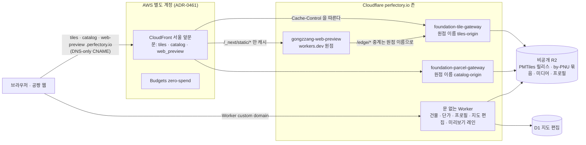

# 전달 계층 — 사용자가 데이터를 받는 길

사용자(공짱 웹·미리보기·외부 클라이언트)는 데이터 호스트나 데이터베이스를 부르지 않는다. 미리 구워 R2 에 둔
불변 객체를 **Cloudflare Worker 게이트웨이**가 읽어 내고, 한국 방문자가 많이 읽는 문 셋은 그 앞에 **서울
CloudFront 앞문**이 선다. 이 문서는 그 모양만 그린다. 값(호스트 이름·캐시 헤더·압축 방식·예산)은 아래 계약이,
이유는 링크한 ADR 이 소유한다 — 여기에 값을 복사하지 않는다([ADR-0176](../adr/0176-generated-docs-do-not-make-unrelated-prs-conflict.md)과
같은 원칙: 문서는 결정을 가리킨다).

## 그림

## 정본

| 무엇 | 정본 | 결정 |
|---|---|---|
| 앞문: 문 목록, 문마다 원점 이름과 `answered_by`(전환·되돌리기 스위치), 캐시 정책, 전송, 예산 | [`cdn-front-door.contract.json`](../../platforms/foundation-platform/config/cdn-front-door.contract.json) → [`infra/cdn/main.tf`](../../platforms/foundation-platform/infra/cdn/main.tf) | [ADR-0461](../adr/0461-korean-visitors-enter-through-a-cloudfront-front-door-in-seoul-in-a-separate-aws-account-applied-by-the-host.md) |
| Worker 게이트웨이: 이름, 공개 호스트·별칭, `Content-Type`, `Cache-Control`, 매니페스트 캐시 초, CPU 한도, 배치 | [`r2-connections.contract.json`](../../platforms/foundation-platform/config/r2-connections.contract.json)(정의 `definitions/*.definition.json` 에서 생성) | 아래 각 행 |
| 어느 Worker 를 어떤 스모크로 배포하나 | [`worker-deploys.contract.json`](../../platforms/foundation-platform/config/worker-deploys.contract.json) | [ADR-0175](../adr/0175-workers-deploy-themselves-after-the-host-deploys-main.md) |

## 경로

| 공개 이름 | 누가 답하나 | 무엇을 | 결정·문서 |
|---|---|---|---|
| `tiles.perfectory.io` | CloudFront → 타일 Worker | 불변 PMTiles 릴리스의 MVT, 바뀐 타일만의 패치 | [ADR-0111](../adr/0111-update-map-tiles-by-changed-tiles-served-from-the-edge.md)·[ADR-0323](../adr/0323-parcel-tiles-patch-only-the-tiles-changed-parcels-touch.md), [README](../../platforms/foundation-platform/services/foundation-tile-gateway/README.md) |
| `catalog.perfectory.io` | CloudFront → 필지 by-PNU Worker | 필지 문서·공매 사진·산업단지 색인/프로필 | [ADR-0096](../adr/0096-parcel-attributes-are-served-from-pre-baked-r2-objects.md)·[ADR-0160](../adr/0160-one-by-pnu-gateway-source-serves-both-lanes.md)·[ADR-0470](../adr/0470-a-mutable-answer-stays-in-a-shared-cache-only-as-long-as-its-worker-holds-the-manifest-and-the-catalog-door-moves-to-seoul.md), [README](../../platforms/foundation-platform/services/foundation-by-pnu-gateway/README.md) |
| `web-preview.perfectory.io` | CloudFront(통과) → 미리보기 Worker | 임시 읽기 전용 공짱 지도 | [ADR-0249](../adr/0249-a-temporary-read-only-web-preview-lives-in-one-free-worker.md), [런북](../../products/gongzzang/docs/runbooks/web-preview.md) |
| 건물·단가 by-PNU, 미리보기 레인, 지도 편집, 산업단지 프로필, `*.gongzzang.app` 별칭 | Worker custom domain(앞문 없음) | 각 레인 문서·편집 오버레이·프로필 | [ADR-0100](../adr/0100-buildings-floors-and-units-are-served-from-pre-baked-r2-objects.md)·[ADR-0193](../adr/0193-each-data-kind-is-its-own-gold-table-and-by-pnu-lane.md), 각 게이트웨이 README |

문 하나를 CloudFront 로 옮기면 Worker 렌더러가 공개 이름을 custom domain 에서 빼고 원점 이름만 붙이며, 호스트의
엣지 적용이 공개 이름을 배포로 가리키는 DNS-only CNAME 을 만든다. 되돌리기는 그 문의 `answered_by` 한 줄이다
(ADR-0461 §6, [엣지 설정 런북](../../platforms/foundation-platform/docs/runbooks/edge-settings.md)). 버전을 판정하는 읽기(배포 스모크·
카나리·capabilities)는 원점 이름으로, 사용자 경험을 재는 읽기(15분 엣지 탐침·매시 서빙 모니터·컷오버 verify)는 공개 이름으로 한다
([Worker 자동 배포 런북](../../platforms/foundation-platform/docs/runbooks/worker-autodeploy.md)).

## 압축

| 답 | 어떻게 | 결정 |
|---|---|---|
| MVT 타일 | PMTiles 안의 gzip 바이트를 그대로 낸다. `Content-Type` 이 `application/x-protobuf` 라 Cloudflare 가 캐시 적중에서도 압축을 유지한다(옛 `vnd.mapbox-vector-tile` 은 적중마다 풀려 나갔다, #1209) | [ADR-0111](../adr/0111-update-map-tiles-by-changed-tiles-served-from-the-edge.md) |
| by-PNU 문서 | 굽기가 문서마다 gzip 한 덩어리를 묶음에 넣고 Worker 는 풀지 않고 `Content-Encoding: gzip` 으로 낸다. gzip 을 받지 않는 클라이언트에게만 푼다 | [ADR-0147](../adr/0147-by-pnu-documents-are-served-from-section-packs.md)·[ADR-0151](../adr/0151-building-packs-serve-each-document-whole.md) |
| CloudFront 문 | `compress` 켜짐, 캐시 키에 br·gzip 정규화. 원점이 이미 인코딩한 답은 그대로 넘긴다. 확인은 `Accept-Encoding` 을 붙여서 한다 | [ADR-0461](../adr/0461-korean-visitors-enter-through-a-cloudfront-front-door-in-seoul-in-a-separate-aws-account-applied-by-the-host.md) §4·[ADR-0470](../adr/0470-a-mutable-answer-stays-in-a-shared-cache-only-as-long-as-its-worker-holds-the-manifest-and-the-catalog-door-moves-to-seoul.md) Context |

## 캐시 수명

CloudFront 는 원점의 `Cache-Control` 을 따른다(`Cache-Control` 없는 답은 저장하지 않는다). 무효화는 쓰지 않는다.

| 주소의 종류 | 브라우저 | 공유 캐시(CloudFront) | 결정 |
|---|---|---|---|
| 불변 — 타일 릴리스, by-PNU 묶음 세대, 미디어, 프로필 | 1년 `immutable` | 1년 | 주소가 내용을 이름한다(ADR-0111·0147) |
| 매니페스트·색인 | 매번 재검증 | 매번 재검증 | 같은 계약의 `manifest_cache_control`·`index_cache_control` |
| 같은 주소의 답이 바뀜 — by-PNU 문서, 패치 타일 | 1시간 | `s-maxage` = 그 Worker 가 매니페스트를 쥐는 초 | [ADR-0470](../adr/0470-a-mutable-answer-stays-in-a-shared-cache-only-as-long-as-its-worker-holds-the-manifest-and-the-catalog-door-moves-to-seoul.md), 가드 [`test_cdn_shared_cache_lifetime.py`](../../platforms/foundation-platform/orchestration/tests/test_cdn_shared_cache_lifetime.py) |
| 미리보기 앱 | — | 통과(캐시 안 함), `/_next/static/*` 만 | ADR-0461 §3 |

## 옛 주소

미리보기의 옛 workers.dev 주소는 앞문의 원점일 뿐이다. CloudFront 를 거치지 않은 요청은 같은 경로·쿼리로
`web-preview.perfectory.io` 에 301(POST 는 308) 한다 — 앞문 주소로 빌드된 페이지가 다른 출처에서 열려 필지 패널이 CORS 로
막혔던 사고(2026-11-10, #1232). 절차는 [미리보기 런북](../../products/gongzzang/docs/runbooks/web-preview.md).

## 비용 가드

| 가드 | 무엇 | 정본 |
|---|---|---|
| AWS Budgets `budget` 블록 | 실제 지출이 첫 1센트를 넘거나 예측이 한도를 넘으면 직원 메일(AWS zero-spend 템플릿). 계획 전체가 CloudFront 상시 무료 한도 안 | `cdn-front-door.contract.json` `budget`, ADR-0461 §7 |
| 적용 키 권한 | 앞문 자원(배포·정책·ACM·예산 하나)뿐, 별도 계정 | [`infra/cdn/apply-policy.json`](../../platforms/foundation-platform/infra/cdn/apply-policy.json) |
| Worker CPU 한도 | 게이트웨이마다 계약 `cpu_limit_ms` 를 `limits.cpu_ms` 로 투영; 카나리 관문이 p99 를 잰다 | `r2-connections.contract.json`, [ADR-0157](../adr/0157-a-canary-step-counts-its-own-answers-and-cpu-is-bound-by-measurement.md) |
| 미리보기 크기 | 압축 크기가 Worker 무료 한도를 넘으면 배포하지 않는다 | [미리보기 런북](../../products/gongzzang/docs/runbooks/web-preview.md) |

## 운영

- 앞문 적용·전환·되돌리기·실측·압축 확인: [엣지 설정 런북](../../platforms/foundation-platform/docs/runbooks/edge-settings.md) §서울 앞문.
- Worker 배포·스모크·엣지 탐침: [Worker 자동 배포 런북](../../platforms/foundation-platform/docs/runbooks/worker-autodeploy.md).
