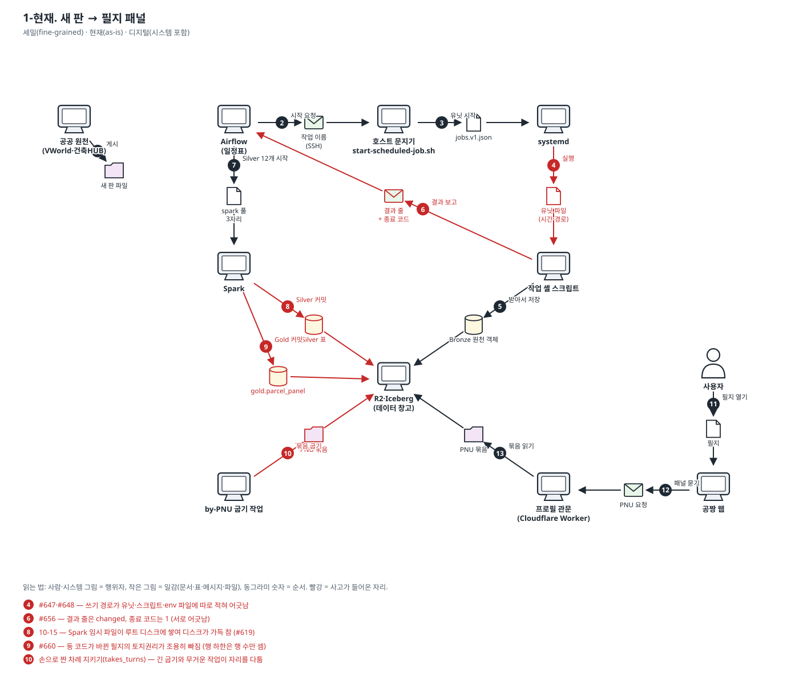
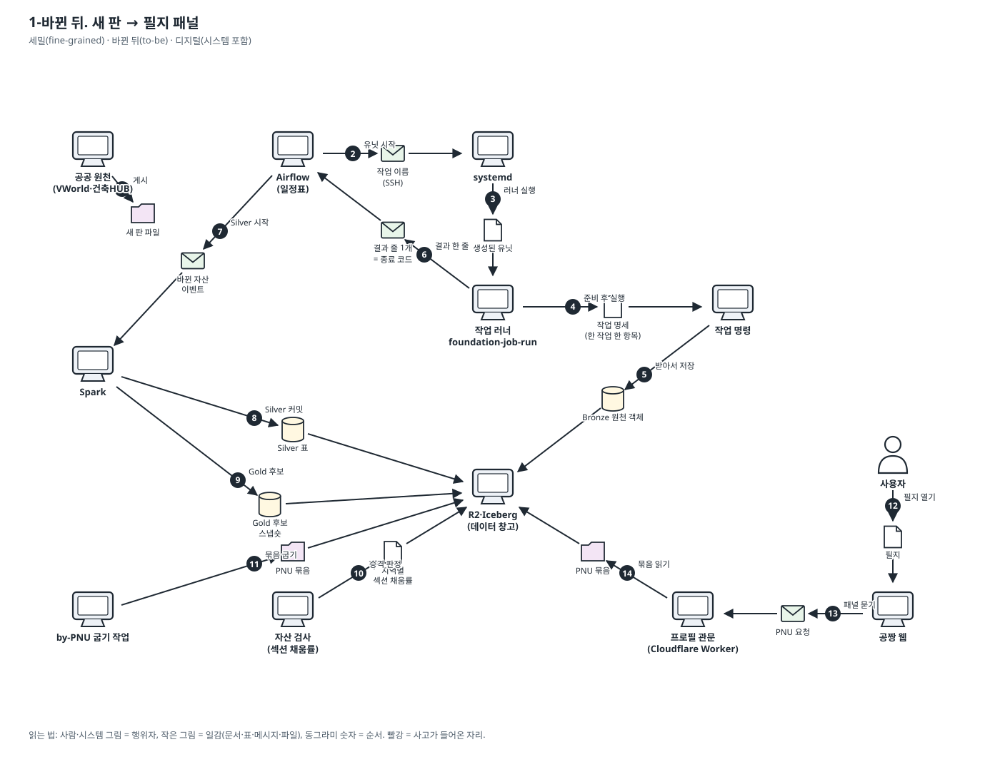

# 이야기 1. 새 판이 나와서 사용자의 필지 패널에 닿기까지

공공 원천이 새 판을 내면, 수집 → Bronze → Silver → Gold → 굽기 → R2 → 관문을 거쳐 사용자 화면에 닿는다.

표기법과 읽는 법은 [도메인 스토리 안내](./README.md)에 있습니다. 결정은 [ADR-0270](../adr/0270-server-jobs-come-from-one-spec-and-run-through-one-runner.md)입니다.

### 1-현재. 새 판 → 필지 패널

- 범위: 세밀(fine-grained) · 현재(as-is) · 디지털(시스템 포함)

1. 공공 원천이 새 판 파일을 게시한다.
2. Airflow 가 새벽 일정에 `source_sweep` 시작 요청을 SSH 로 호스트 문지기에게 보낸다.
3. 호스트 문지기가 `jobs.v1.json` 에서 작업을 찾아 systemd 에게 그 유닛을 시작시킨다.
4. systemd 가 유닛 파일에 손으로 적힌 시간 상한·쓰기 경로로 셸 스크립트를 실행한다. — **🔴 사고: #647·#648 — 쓰기 경로가 유닛·스크립트·env 파일에 따로 적혀 어긋남**
5. 수집 스크립트가 원천에서 새 파일을 받아 Bronze 객체로 창고에 쓴다.
6. 스크립트가 마지막에 `foundation-job-outcome` 줄을 찍고, 문지기가 그 줄을 Airflow 에 돌려준다. — **🔴 사고: #656 — 결과 줄은 changed, 종료 코드는 1 (서로 어긋남)**
7. Airflow 가 '입력이 바뀌었다'를 보고 Silver 갱신 12개를 `spark` 풀 자리 수대로 시작한다.
8. Spark 가 Bronze 를 읽어 Silver 표를 창고에 커밋한다. — **🔴 사고: 10-15 — Spark 임시 파일이 루트 디스크에 쌓여 디스크가 가득 참 (#619)**
9. Spark 가 Silver 를 PNU 로 붙여 필지 패널 Gold 를 쓴다. — **🔴 사고: #660 — 동 코드가 바뀐 필지의 토지권리가 조용히 빠짐 (행 하한은 행 수만 셈)**
10. by-PNU 굽기가 Gold 를 읽어 PNU 묶음을 R2 에 굽는다 (시간 상한 21시간). — **🔴 사고: 손으로 짠 차례 지키기(takes_turns) — 긴 굽기와 무거운 작업이 자리를 다툼**
11. 사용자가 공짱 웹에서 필지를 연다.
12. 공짱 웹이 프로필 관문에 그 필지의 패널을 묻는다.
13. 프로필 관문이 R2 의 묶음을 읽어 값을 돌려주고, 웹이 화면을 그린다.

확인한 실물: `orchestration/jobs.v1.json`, `orchestration/job-dependencies.v1.json`, `scripts/ops/start-scheduled-job.sh`, `infra/systemd/foundation-parcel-registry.service`, `infra/systemd/foundation-gold-panel-rebuild.service`

### 1-바뀐 뒤. 새 판 → 필지 패널

- 범위: 세밀(fine-grained) · 바뀐 뒤(to-be) · 디지털(시스템 포함)

1. 공공 원천이 새 판 파일을 게시한다.
2. Airflow 가 작업 이름 하나를 보내고, systemd 가 그 작업의 생성된 유닛을 시작한다.
3. systemd 가 작업 명세에서 생성된 유닛으로 작업 러너를 실행한다. 시간·경로·샌드박스는 모두 명세에서 왔다.
4. 러너가 작업 명세를 읽어 릴리스를 고정하고, 실행 폴더를 /data 에 만들고, 무거운 자리를 얻은 뒤 명령을 실행한다.
5. 수집 명령이 원천에서 새 파일을 받아 Bronze 객체로 창고에 쓴다.
6. 러너가 명령의 결과를 읽어 마지막 줄 하나로 찍고 같은 뜻의 종료 코드로 끝난다. 실행 폴더를 지운다.
7. Airflow 가 Bronze 자산이 바뀐 것을 보고 Silver 갱신을 시작한다. 자리는 러너가 우선순위대로 준다.
8. Spark 가 Silver 표를 커밋한다. 임시 파일은 그 실행의 폴더(/data)에만 쓴다.
9. Spark 가 Gold 후보 스냅숏을 쓴다. 아직 서빙하지 않는다.
10. 자산 검사가 지역마다 섹션 채움률을 계약의 하한과 비교한다. 하한 아래면 승격하지 않고 실패로 끝낸다.
11. by-PNU 굽기가 승격된 Gold 만 읽어 묶음을 굽는다. 차례는 러너의 대기열이 정한다.
12. 사용자가 공짱 웹에서 필지를 연다.
13. 공짱 웹이 프로필 관문에 패널을 묻는다.
14. 프로필 관문이 R2 의 묶음을 읽어 값을 돌려준다.
