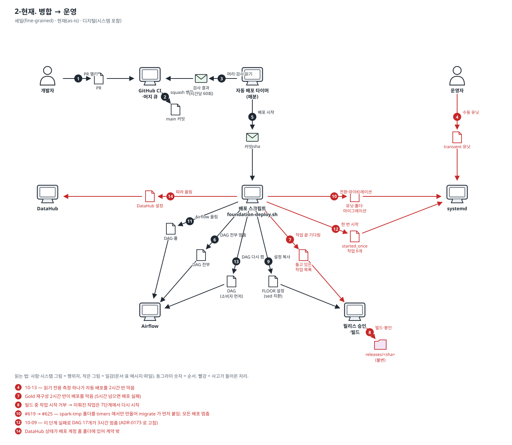
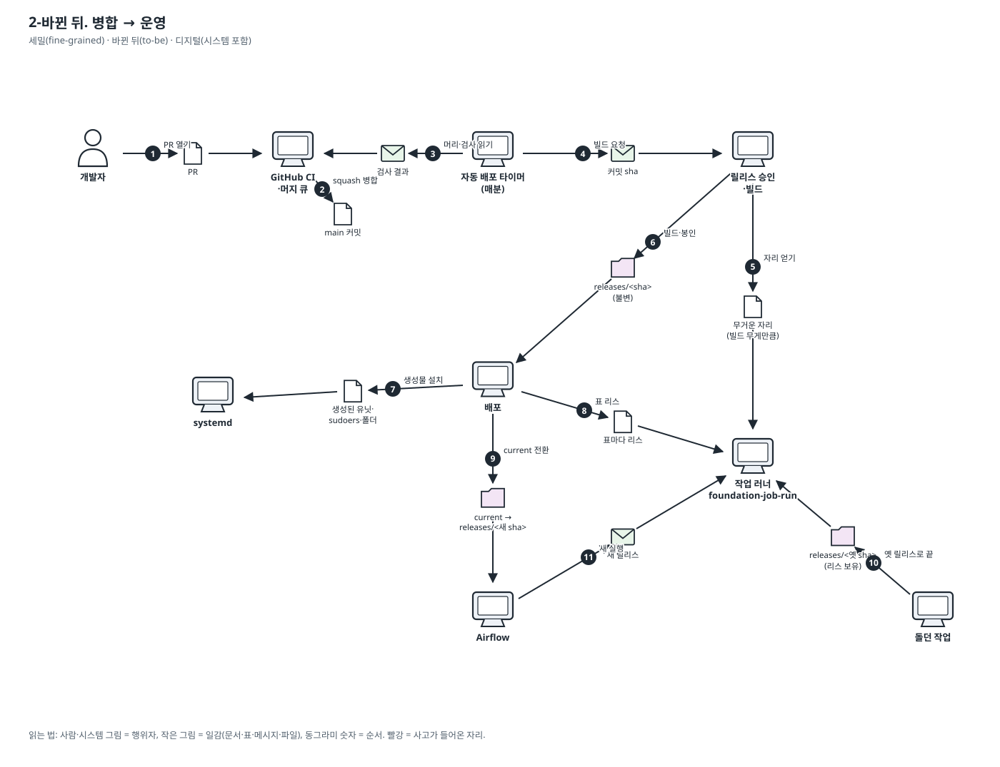

# 이야기 2. 개발자가 고침을 병합해서 운영에서 돌기까지

PR → CI → 머지 큐 → 자동 배포(사전 점검, 0~8단계) → 한 번 시작 작업 → DAG 재개.

표기법과 읽는 법은 [도메인 스토리 안내](./README.md)에 있습니다. 결정은 [ADR-0270](../adr/0270-server-jobs-come-from-one-spec-and-run-through-one-runner.md)입니다.

### 2-현재. 병합 → 운영

- 범위: 세밀(fine-grained) · 현재(as-is) · 디지털(시스템 포함)

1. 개발자가 PR 을 연다.
2. CI 가 통과하면 머지 큐가 main 에 squash 병합한다.
3. 자동 배포 타이머가 매분 main 머리를 읽고, 5분에 한 번 검사 결과를 묻는다.
4. 운영자가 손으로 띄운 유닛이 돌면 자동 배포는 다음 분까지 기다린다. — **🔴 사고: 10-13 — 읽기 전용 측정 하나가 자동 배포를 2시간 반 막음**
5. 자동 배포가 배포 스크립트를 그 커밋으로 부른다.
6. 배포가 승인 대기 마이그레이션을 사전 점검한 뒤 DAG 를 전부 멈춘다 (0단계).
7. 배포가 등록된 작업이 하나도 안 돌 때까지 10초마다 묻는다. 5시간 넘으면 배포 실패. — **🔴 사고: Gold 재구성 2시간 반이 배포를 막음 (5시간 넘으면 배포 실패)**
8. 릴리스 승인이 빌드 잠금을 잡고 releases/&lt;sha&gt; 를 빌드·봉인한다. 그동안 모든 작업의 시작을 거부한다. — **🔴 사고: 빌드 중 작업 시작 거부 → 미뤄진 작업은 7단계에서 다시 시작**
9. 배포가 옛 릴리스의 FLOOR 설정을 복사해 sed 로 경로·이미지를 바꾼다 (3단계).
10. 배포가 activate → migrate → timers 를 차례로 한다 (4단계). — **🔴 사고: #619 → #625 — spark-tmp 폴더를 timers 에서만 만들어 migrate 가 먼저 붙임: 모든 배포 멈춤**
11. 배포가 Airflow 를 새 DAG·풀로 올린다 (5단계).
12. 배포가 '배포 뒤 한 번' 작업 6개를 하나씩 시작해 끝을 기다린다 (6단계). — **🔴 사고: 10-09 — 이 단계 실패로 DAG 17개가 3시간 멈춤 (ADR-0173 로 고침)**
13. 배포가 DAG 를 소비자 먼저 다시 켠다 (7단계).
14. 배포가 설정이 바뀐 DataHub 컨테이너를 따라 올린다 (8단계). — **🔴 사고: DataHub 상태가 배포 계정 홈 폴더에 있어 계약 밖**

확인한 실물: `scripts/deploy/foundation-autodeploy.sh`, `scripts/deploy/foundation-deploy.sh`, `scripts/deploy/deploy-start-once.sh`, `scripts/deploy/foundation-release.sh`, `scripts/deploy/foundation-release-admission.py (루트)`

### 2-바뀐 뒤. 병합 → 운영

- 범위: 세밀(fine-grained) · 바뀐 뒤(to-be) · 디지털(시스템 포함)

1. 개발자가 PR 을 연다. CI 가 명세에서 만든 생성물이 저장소와 같은지 본다.
2. 머지 큐가 main 에 squash 병합한다.
3. 자동 배포 타이머가 main 머리와 검사 결과를 읽는다.
4. 자동 배포가 릴리스 승인에게 그 커밋의 빌드를 맡긴다. 운영자 유닛이 돌아도 기다리지 않는다.
5. 빌드는 무거운 작업 하나로 러너의 대기열에 선다. 돌던 작업은 멈추지 않고, 새 무거운 작업이 빌드를 앞지르지 않는다.
6. 승인이 releases/&lt;sha&gt; 를 빌드하고 봉인한다.
7. 배포가 명세에서 생성된 유닛·sudoers·폴더를 설치한다. 폴더는 어떤 마운트보다 먼저 만든다.
8. 배포가 마이그레이션이 바꾸는 표마다 리스를 잡는다. 그 표를 쓰는 작업이 돌면 그 마이그레이션만 기다린다.
9. 배포가 current 를 새 릴리스로 한 번에 바꾼다. DAG 는 멈추지 않는다.
10. 이미 돌던 작업은 시작한 옛 릴리스로 끝까지 돈다. 정리(prune)는 리스가 남은 릴리스를 지우지 않는다.
11. 그 뒤의 새 실행은 러너가 새 릴리스로 고정한다.
