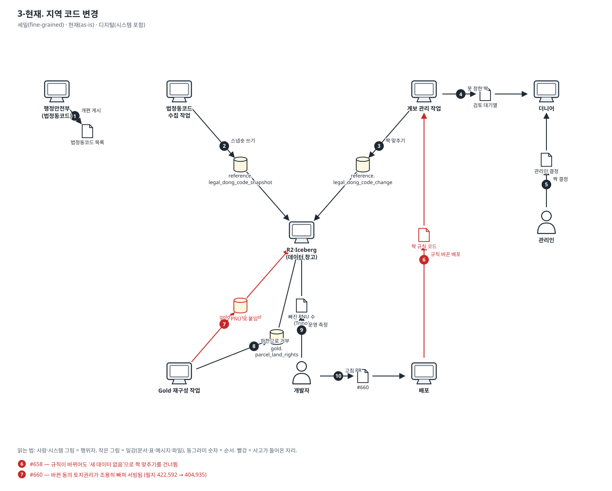
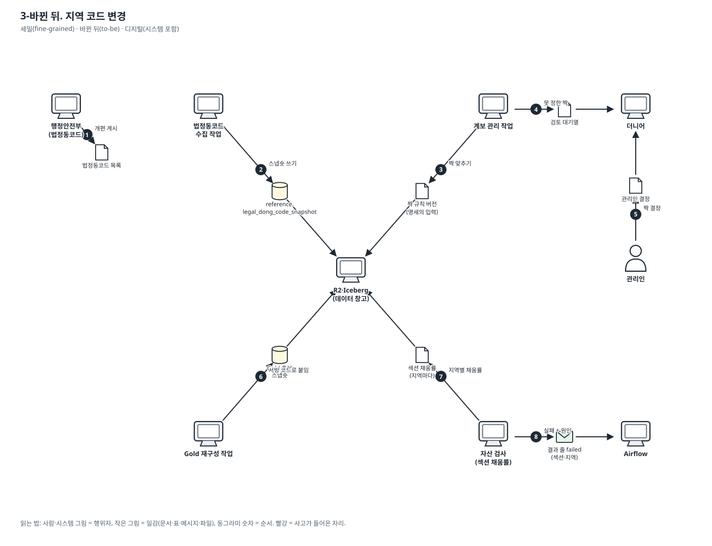

# 이야기 3. 지역 코드가 바뀌어서(인천 2026-07) 계보·짝 맞추기에 관리인이 필요할 때

법정동코드가 바뀌면 옛 코드 → 새 코드 짝을 맞추고, 데이터가 못 정한 짝은 관리인이 정한다. 그 뒤 Gold 가 새 코드로 다시 붙는다.

표기법과 읽는 법은 [도메인 스토리 안내](./README.md)에 있습니다. 결정은 [ADR-0270](../adr/0270-server-jobs-come-from-one-spec-and-run-through-one-runner.md)입니다.

### 3-현재. 지역 코드 변경

- 범위: 세밀(fine-grained) · 현재(as-is) · 디지털(시스템 포함)

1. 행정안전부가 법정동코드 개편(인천 2026-07)을 게시한다.
2. 법정동코드 수집 작업이 새 코드 목록을 받아 스냅숏 표에 쓴다.
3. 계보 관리 작업이 옛·새 스냅숏을 비교해 옛 코드 → 새 코드 짝을 맞춰 쓴다.
4. 데이터로 못 정한 짝을 검토 대기열에 올린다.
5. 관리인이 더니어에서 검토 목록을 보고 짝을 정한다 (ADR-0263).
6. 짝 규칙을 고친 배포가 나간다. — **🔴 사고: #658 — 규칙이 바뀌어도 '새 데이터 없음'으로 짝 맞추기를 건너뜀**
7. Gold 재구성이 Silver 섹션을 서빙 판의 PNU 로 붙인다. Silver 는 자기 판의 새 코드, 서빙 판은 옛 코드다. — **🔴 사고: #660 — 바뀐 동의 토지권리가 조용히 빠져 서빙됨 (필지 422,592 → 404,935)**
8. kind Gold 의 행 하한이 토지권리 표를 거부한다 (이번엔 여기서 잡힘).
9. 개발자가 운영 Trino 로 빠진 수를 재서 원인을 찾는다.
10. 개발자가 코드를 서빙 판 코드로 다시 붙이는 고침을 병합하고 배포한다.

확인한 실물: `orchestration/jobs.v1.json (legal_dong_code_changes, lineage_stewardship)`, `PR #658`, `PR #660`, `docs/adr/0263-legal-dong-pairs-are-decided-on-the-one-steward-path.md`

### 3-바뀐 뒤. 지역 코드 변경

- 범위: 세밀(fine-grained) · 바뀐 뒤(to-be) · 디지털(시스템 포함)

1. 행정안전부가 법정동코드 개편을 게시한다.
2. 수집 작업이 스냅숏 표에 쓴다.
3. 계보 관리 작업이 짝을 맞춘다. 짝 규칙 버전은 명세에 적힌 입력이라, 규칙이 바뀌어도 새 데이터처럼 다시 맞춘다.
4. 못 정한 짝을 검토 대기열에 올린다.
5. 관리인이 더니어에서 짝을 정한다.
6. Gold 재구성이 바뀐 코드를 서빙 판 코드로 옮겨 붙인 후보를 쓴다.
7. 자산 검사가 지역마다 '토지권리 원천이 있는 필지 중 토지권리가 붙은 비율'을 계약 하한과 비교한다.
8. 하한 아래면 승격하지 않고, 어느 섹션·어느 지역인지 원인 한 줄로 실패한다. 서빙은 옛 Gold 그대로다.
