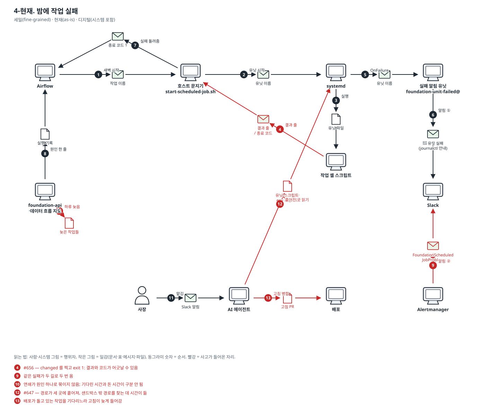
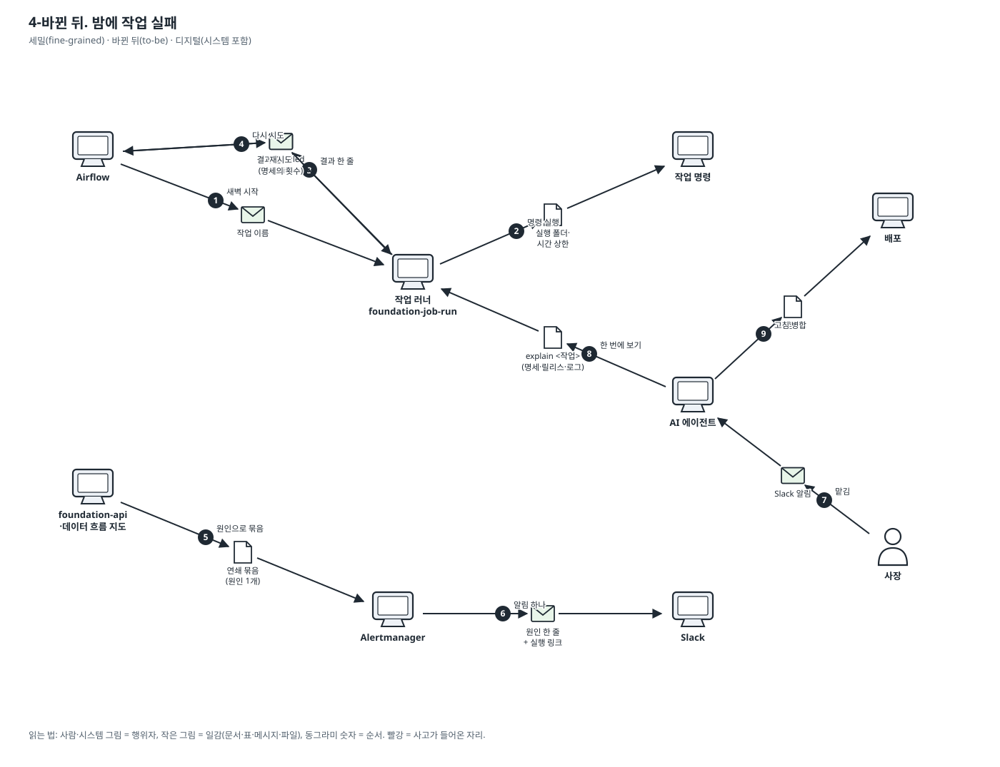

# 이야기 4. 밤에 작업이 실패했을 때: 누가 알고, 어떻게 진단하고, 어떻게 되살리나

새벽에 작업 하나가 실패하면 알림 → 진단 → 고침 → 다시 돌기까지.

표기법과 읽는 법은 [도메인 스토리 안내](./README.md)에 있습니다. 결정은 [ADR-0270](../adr/0270-server-jobs-come-from-one-spec-and-run-through-one-runner.md)입니다.

### 4-현재. 밤에 작업 실패

- 범위: 세밀(fine-grained) · 현재(as-is) · 디지털(시스템 포함)

1. Airflow 가 새벽 일정에 작업을 호스트 문지기에게 시작시킨다.
2. 문지기가 systemd 에게 유닛을 시작시킨다.
3. systemd 가 셸 스크립트를 실행하고, 스크립트가 실패한다.
4. 스크립트가 결과 줄과 종료 코드를 남긴다. — **🔴 사고: #656 — changed 를 찍고 exit 1: 결과와 코드가 어긋날 수 있음**
5. systemd 가 OnFailure 로 실패 알림 유닛을 시작한다.
6. 실패 알림 유닛이 Slack 에 '유닛 실패'를 보낸다.
7. 문지기가 결과 줄을 판정해 Airflow 에 실패를 돌려준다 (ADR-0260).
8. foundation-api 가 Airflow 기록에서 원인 한 줄을 읽어 지도를 빨갛게 한다.
9. Alertmanager 가 같은 실패를 Slack 에 또 보낸다. — **🔴 사고: 같은 실패가 두 길로 두 번 옴**
10. 하류 작업들이 줄줄이 늦음으로 보인다. — **🔴 사고: 연쇄가 원인 하나로 묶이지 않음; 기다린 시간과 돈 시간이 구분 안 됨**
11. 아침에 사장이 알림을 보고 AI 에이전트에게 맡긴다.
12. 에이전트가 ssh 로 journalctl·유닛·스크립트·env 파일을 읽어 진단한다. — **🔴 사고: #647 — 경로가 세 곳에 흩어져, 샌드박스 밖 경로를 찾는 데 시간이 듦**
13. 에이전트가 고침을 병합하면 배포가 나가고, 다음 일정에 다시 돈다. — **🔴 사고: 배포가 돌고 있는 작업을 기다리느라 고침이 늦게 들어감**

확인한 실물: `scripts/ops/notify-unit-failure.sh`, `scripts/ops/start-scheduled-job.sh`, `docs/adr/0208-the-data-flow-maps-problems-reach-slack-through-the-existing-alertmanager.md`, `docs/adr/0260-a-scheduled-job-ends-by-saying-its-outcome-and-silence-is-failure.md`

### 4-바뀐 뒤. 밤에 작업 실패

- 범위: 세밀(fine-grained) · 바뀐 뒤(to-be) · 디지털(시스템 포함)

1. Airflow 가 작업을 시작시키고, systemd 가 러너를 실행한다.
2. 러너가 실행 폴더와 시간 상한을 걸고 명령을 실행한다. 명령이 실패한다.
3. 러너가 마지막 줄 하나와 같은 뜻의 종료 코드로 끝난다. 명령은 마지막 줄을 쓸 수 없다.
4. 주기 작업은 다음 주기가 곧 재시도다. 명세가 `retry` 이고 `idempotent` 인 작업만 Airflow 가 다시 시도한다.
5. 지도가 이 실패를 원인으로, 기다리는 하류를 그 아래에 묶고, 기다린 시간과 돈 시간을 따로 보인다.
6. Alertmanager 가 Slack 에 알림 하나를 보낸다.
7. 사장이 알림을 보고 AI 에이전트에게 맡긴다.
8. 에이전트가 러너의 explain 으로 명세·고정된 릴리스·경로·실행 기록·로그 끝을 한 번에 본다.
9. 고침이 병합되면 배포는 돌던 작업을 기다리지 않고 나가고, 다음 실행이 새 릴리스로 돈다.
